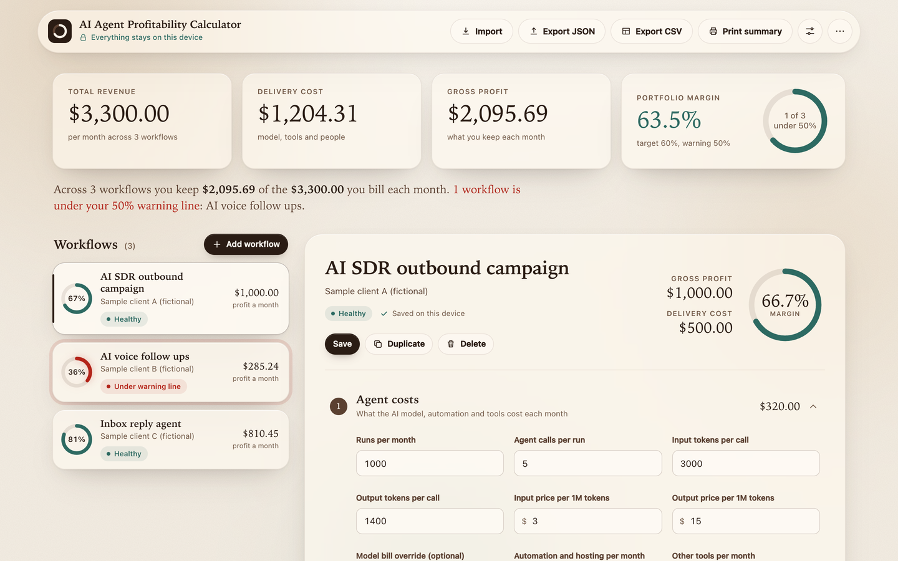
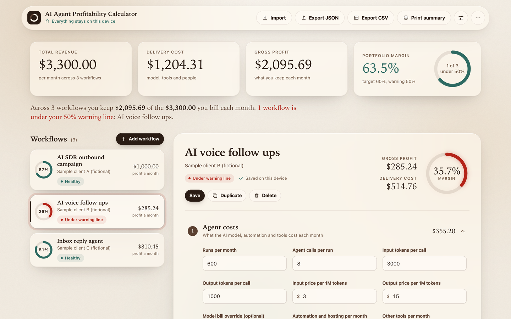
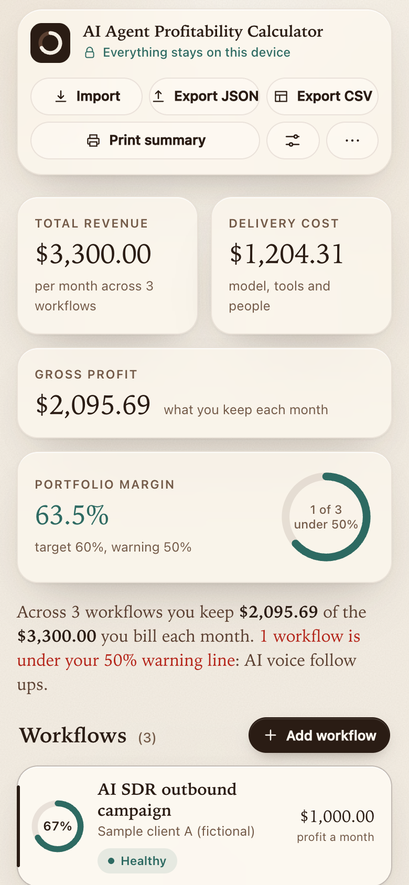

# AI Agent Profitability Calculator

Find out how much profit each AI workflow really makes, after tokens, retries, tools and human time.

## Quick start with Claude Code

Give Claude this repo link and say:

> Set up the AI Agent Profitability Calculator for me, open the app, and help me fill in my first workflow.

Repo: https://github.com/onittindwani-ai/ai-agent-profitability-calculator

Claude asks you simple questions, saves your numbers on your computer, runs the calculator and explains the top 3 fixes.

## 3 ways to use it

| Way | How to open it | Guide |
| --- | --- | --- |
| **The app** | Double click `app/index.html`, or run `python3 tools/serve.py` (opens http://localhost:8765) | [docs/01-THE-APP.md](docs/01-THE-APP.md) |
| **The spreadsheet** | Open [AI-Agent-Profitability-Calculator.xlsx](AI-Agent-Profitability-Calculator.xlsx) in Excel, or Google Sheets (File > Import) | [docs/02-THE-SPREADSHEET.md](docs/02-THE-SPREADSHEET.md) |
| **Claude Code** | Say "audit my AI workflow costs", or use `/margin-audit` and `/margin-report` | [docs/03-WITH-CLAUDE-CODE.md](docs/03-WITH-CLAUDE-CODE.md) |

All three use the same math, and they match to the cent. No install, no account, no internet needed.

## What it calculates

1. **Agent cost tracker**: what the AI model costs per month, from runs, agent calls, tokens and your price per 1M tokens (or from your
   real bill), plus infrastructure and tools.
2. **Hidden cost tracker**: retries, human review and upkeep. The costs most people forget.
3. **Cost per outcome**: what each qualified lead, booked meeting or handled reply really costs you, and what it earns.
4. **Agency profit calculator**: delivery cost, gross profit and margin per workflow and for all your workflows together, plus the price
   that reaches your target margin.
5. **Recommendations**: what to fix first, like a model that eats too much of the budget, high retries, agents passing work back and forth,
   or a margin under 50 percent.

## The example (fictional)

An AI SDR outbound campaign:

| | Per month |
| --- | --- |
| Client pays | **$1,500** |
| AI model (including $30 of retries) | $180 |
| Automation and infrastructure | $70 |
| Other tools | $100 |
| Human review and upkeep | $150 |
| **Total delivery cost** | **$500** |
| **Gross profit** | **$1,000** |
| **Gross margin** | **66.7%** |

The samples also include an AI voice follow up workflow that sits at 35.7 percent, under the 50 percent warning line, so you can see what
a red workflow looks like. How every number is worked out: [docs/04-HOW-THE-MATH-WORKS.md](docs/04-HOW-THE-MATH-WORKS.md).

## Screenshots

Real screenshots of the app, taken from the running app on desktop and phone width: [screenshots/](screenshots/)







More screenshots:

- [The recommendations](screenshots/desktop-recommendations.png)
- [The full workflow editor](screenshots/desktop-workflow-detail-full-page.png)
- [A button while it works](screenshots/desktop-button-processing.png) and [when it is done, with a toast](screenshots/desktop-button-done-and-toast.png)
- [A field that tells you a number is not valid](screenshots/desktop-invalid-input.png)
- [Delete with undo](screenshots/desktop-delete-with-undo.png)
- [Settings](screenshots/desktop-settings.png)
- [Phone, red warning](screenshots/phone-red-warning.png) and [phone, full page](screenshots/phone-full-page.png)

## Use the command line tool

```
python3 tools/margin.py check      # check your data/workflows.json for mistakes
python3 tools/margin.py report     # readable report with recommendations
python3 tools/margin.py json       # machine readable output
python3 tools/margin.py csv        # one row per workflow
```

Python 3.9 or newer, standard library only. To rebuild the spreadsheet: `pip install openpyxl`, then `python3 tools/build_workbook.py`.

## Privacy

Everything stays on your device. The app, the spreadsheet and the tools make no network calls and send nothing anywhere. The app saves
your numbers in your own browser only. More in [docs/SECURITY.md](docs/SECURITY.md).

## Good to know

- Token prices in the samples are example rates. Replace them with your provider's current price per 1M tokens.
- The sample workflows and clients are fictional.
- It is an estimate, not financial advice. Read [docs/LIMITS-AND-HONESTY.md](docs/LIMITS-AND-HONESTY.md).

## Docs

- [Start here](docs/00-START-HERE.md)
- [The app](docs/01-THE-APP.md)
- [The spreadsheet](docs/02-THE-SPREADSHEET.md)
- [With Claude Code](docs/03-WITH-CLAUDE-CODE.md)
- [How the math works](docs/04-HOW-THE-MATH-WORKS.md)
- [Cut your costs](docs/05-CUT-YOUR-COSTS.md)
- [Limits and honesty](docs/LIMITS-AND-HONESTY.md)
- [Security](docs/SECURITY.md)

## Run the tests

```
python3 -m unittest discover tests
node --test tests/engine.test.mjs
python3 tests/check_kit.py
```

## Licence

MIT, Copyright (c) 2026 Onit Tindwani. See [LICENSE](LICENSE). Version 1.0.0, see [CHANGELOG.md](CHANGELOG.md).
